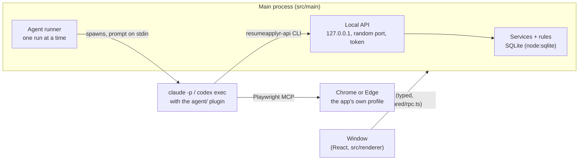

# resumeapplyr for desktop

The desktop app is the part of resumeapplyr that actually applies for jobs. It runs on the user's own
computer: it finds postings on the job boards they pick, scores each one against their CV, tailors a
copy of the CV for the jobs worth sending, and fills in the application in a real browser. It only
sends what the user allows.

It is local-first. The database, CVs and the agent's browser profile live in the app's data folder,
and nothing goes to a resumeapplyr server. The AI is the user's own **Claude Code** or **Codex**,
run headless on their own subscription, so the app needs no API key and adds no AI cost.

Much of the agent design comes from [JobPilot](https://github.com/suxrobgm/jobpilot) (MIT), adapted
for a desktop app; see [What came from JobPilot](#what-came-from-jobpilot).

## How it fits together



- **`src/main/services`** hold the data and every rule that matters (below). The window and the
  agent both go through them, so a rule can't be skipped by either.
- **`src/main/api`** is the HTTP API the agent uses, with JobPilot-compatible routes. It listens
  on 127.0.0.1 only, on a random port, and requires a per-launch bearer token. It rejects requests
  whose Host header isn't the loopback address, so a web page can't reach it by DNS rebinding.
- **`src/main/agent`** starts Claude Code or Codex headless. It feeds the skill in on stdin, turns
  their JSON output into the Agent screen's activity feed, enforces the run time limit and cleans
  up after a stop or crash.
- **`agent/`** is the plugin the agent runs. It holds the skills (`search`, `auto-apply`, `apply`,
  `tailor-resume`, `extract-resume`, `review-resume`, `cover-letter`, `humanizer`), the two
  workers (`job-scorer`, `job-applier`), shared guidance, and the `resumeapplyr-api` command.
- **`src/core`** is pure logic with unit tests: fit scoring, duplicate detection, job-link
  canonicalisation, the tailoring guards that keep invented facts out of a CV, and the
  profile/CV consistency check.
- **`src/renderer`** is the window, built on the Modernist design system with Archivo bundled.

### Screens

| Screen | What it's for |
| --- | --- |
| Home | Setup checklist on first run, today's numbers, jobs waiting for a decision, recent runs |
| Campaigns | One search on one board, or a list of pasted links. Jobs with scores and reasons; approve, skip, apply |
| Applications | Everything sent, with status tracking, notes, history and cover letters. Manual entries keep the agent from applying twice |
| CVs | Upload a PDF (the agent reads it into sections) or write one; edit with a live print preview; tailored versions; suggested rewrites to accept or discard |
| Profile | What application forms ask for: contact details, address, right to work, salary ranges, references, equal-opportunity answers |
| Agent | The live activity feed of the current run, and every past run with its cost |
| Settings | AI tool and model, the agent's browser (and signing in to boards), sending rules, job boards, saved answers, paper size, data folder |

When the agent needs the user, such as for a sign-in, a verification code, a CAPTCHA or a question
only they can answer, a banner appears above every screen and the system shows a notification. The
agent waits for the answer through the API.

## Rules the app enforces

The agent has to move a job to `applying` through the API before it submits anything. The app
refuses the move when:

- **Approval**: in *approve-first* mode (the default), the user hasn't approved the job. In
  *auto-send* mode, the job hasn't been approved and scores below the auto-send threshold.
- **Daily limit**: today's applications plus those in flight would go over the limit (default 25).
- **Campaign limit**: the campaign's own cap has been reached.
- **Paused**: the campaign is paused.
- **Already applied**: the same link at any age (canonicalised, ignoring tracking parameters), or
  a near-identical title at the same company within 30 days (Jaro-Winkler). The job is recorded
  as skipped.
- **In flight**: another run is applying to the same posting right now.

Anything recorded as sent without passing these checks is flagged *Sent without the app's
checks* in Applications.

The skills also tell the agent never to create accounts, type passwords, use single sign-on, solve
or bypass CAPTCHAs, or guess codes. It asks the user instead. Tailoring can reword and reorder a
CV but not add facts; the guards in `src/core/tailoring` reject a variant that does.

## What a user needs

- **Claude Code** (signed in once in a terminal) or **Codex** (`codex login`). Settings shows what
  the app found, and whether the installed version supports the flags it needs.
- **Node.js 20 or newer**, for the browser tool (`npx @playwright/mcp`) and the `resumeapplyr-api` command.
- **Google Chrome** or **Microsoft Edge**. The agent drives it with a profile of its own, separate
  from the user's everyday browser. The user signs in to each board there once (Settings → *The
  agent's browser*).

## Data

Everything is in Electron's user-data folder for the app:

| OS | Folder |
| --- | --- |
| Windows | `%APPDATA%\resumeapplyr` |
| macOS | `~/Library/Application Support/resumeapplyr` |
| Linux | `~/.config/resumeapplyr` |

Inside: `resumeapplyr.db` (SQLite), `cvs/` (uploaded PDFs), `browser-profile/` (the agent's
browser), and `agent-workspace/runs/` (per-run scratch, removed after 14 days). Run activity is
kept for 30 days. Settings → *Your data* opens the folder.

## Developing

```sh
cd apps/desktop
npm install
npm run dev          # the app with a hot-reloading window
npm run typecheck    # main/preload and window code
npm test             # unit, API and runner tests (Vitest)
npm run test:e2e     # builds, then drives the real app end to end (Linux: prefix with xvfb-run -a)
```

`test:e2e` starts Electron on a throwaway data folder with a fake `claude` on `PATH`
(`tests/fixtures/fake-agent*.mjs`). The fake speaks Claude Code's real output format and calls the
real API, and the test walks through the whole loop. It fills in a profile, writes a CV and exports
it as a PDF, then starts a campaign and answers the agent's question in the banner. It approves a
job, applies, and checks Applications, Agent and Settings. Set `E2E_SCREENSHOTS=<folder>` to keep a
screenshot of every screen.

Useful environment variables:

- `RESUMEAPPLYR_USER_DATA`: use another data folder (tests use this).
- `RESUMEAPPLYR_BROWSER_EXECUTABLE`: a browser binary for the sign-in window, instead of the
  Chrome/Edge channel.

## Releases

Version numbers come from `apps/desktop/package.json`.

**On your machine:** `npm run dist` builds installers for the current OS into
`apps/desktop/release/<version>/`. Use `dist:win`, `dist:mac` or `dist:linux` to pick one. To check
an unpacked build, run `npm run test:packaged -- <path to the built executable>`. It confirms the
app starts, finds its bundled agent plugin and renders without errors.

**From GitHub:** push a tag such as `desktop-v0.1.0`. `.github/workflows/desktop-release.yml` builds
a Windows installer (NSIS), a macOS DMG (Apple silicon and Intel), and a Linux AppImage and `.deb`.
It attaches them to a **draft** release for review before publishing.

**Signing.** Builds are unsigned for now. Windows shows a SmartScreen warning, and macOS blocks
the app until the user right-clicks it and chooses *Open*. To sign:

- Windows: a code-signing certificate as `CSC_LINK` / `CSC_KEY_PASSWORD` secrets, or Azure Trusted
  Signing.
- macOS: a Developer ID certificate (`CSC_LINK`, `CSC_KEY_PASSWORD`) and notarisation
  credentials (`APPLE_ID`, `APPLE_APP_SPECIFIC_PASSWORD`, `APPLE_TEAM_ID`).

Then remove `CSC_IDENTITY_AUTO_DISCOVERY: "false"` from the release workflow.

## What came from JobPilot

Taken and adapted: the campaign model and its job states, the skills and workers (search,
auto-apply, apply, tailoring, CV extraction and review, cover letters), the
`jobpilot-api` client (now `resumeapplyr-api`), fit scoring with skill synonyms and eligibility
checks, applied-job duplicate detection, job-link canonicalisation, the tailoring guards, and the
profile/CV consistency check. The humanizer skill comes from blader/humanizer (MIT).

Left out on purpose: Gmail scanning, LinkedIn networking campaigns, Upwork, the autonomous
"pilot", automatic account sign-up and password resets, CAPTCHA-solving services, and anything
meant to evade a site's bot detection.

## Known gaps

- The tests use a fake agent. The first run against a real Claude Code or Codex session should be
  watched from the Agent screen.
- Installers have only been built and smoke-tested on Linux. Windows-specific launching (npm
  `.cmd` shims) is covered by unit tests.
- There is no auto-update yet.
- The design system's light text on vermilion (primary buttons) is 3.75:1, under WCAG AA for
  small text. It should be fixed in the Modernist tokens, which both the site and the app use.
