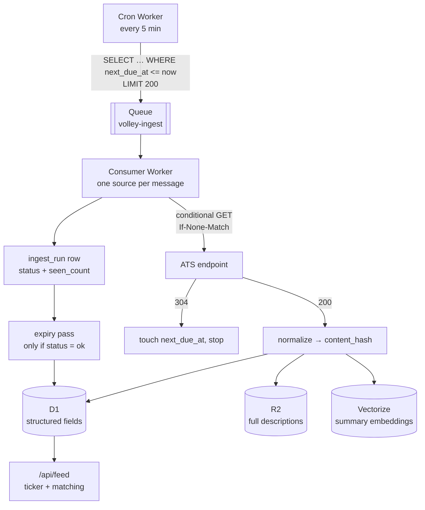

# resumeapplyr — job ingestion architecture

Status: design, not yet built. Written 21 Aug 2026.

> **Note (13 Oct 2026):** the product is now called resumeapplyr (it was resumeapplyr when this was
> written), and the landing page no longer claims "41 boards" or "polls every fifteen minutes".
> The first build is the desktop app in `apps/desktop`, where the agent searches boards in the
> user's own browser; this server-side pipeline is still the plan for a shared job feed.

The landing page already makes three promises: *41 boards and ATS feeds watched*,
*polls every fifteen minutes*, *dedupes the same job posted in four places*. This
document is how those become true, and what each one actually costs.

Every endpoint below was called live on 21 Aug 2026 unless marked otherwise.

---

## 1. The premise

resumeapplyr's product is not "a list of jobs" — a hundred sites have that. It is *this
posting, open right now, scored against your CV*. Two properties carry the whole
thing:

- **Freshness.** A posting that closed last week is worse than no posting, because
  the user spends a real application on it.
- **Identity.** The same role reached through Greenhouse, LinkedIn and an
  aggregator must be one thing, or the user gets three notifications and applies
  twice.

Both are ingestion problems, and both are solved by *how you expire records*, not
by how you fetch them. Fetching is the easy half.

---

## 2. Source tiers

Three tiers, in strict order of preference. Always take a job from the
lowest-numbered tier that has it.

### Tier A — ATS public endpoints

Employers publish these deliberately so their jobs can be syndicated. No key, no
crawling, structured JSON, and the data is first-party: it is the requisition
itself, not someone's copy of it. **One HTTP call returns a company's entire open
board.**

| ATS | Endpoint | Auth | Full description | Notes |
| --- | --- | --- | --- | --- |
| **Greenhouse** | `GET boards-api.greenhouse.io/v1/boards/{slug}/jobs?content=true` | none | yes, `content` (HTML-escaped) | `{jobs:[…]}`. Fields: `id`, `title`, `absolute_url`, `updated_at`, `first_published`, `location`, `departments`, `offices`, `requisition_id`, `content`. Verified live. |
| **Lever** | `GET api.lever.co/v0/postings/{slug}?mode=json` | none | yes, `descriptionPlain` + `description` | Returns a bare array. `categories{commitment,department,location,team,allLocations}`, `hostedUrl`, `applyUrl`, `workplaceType`, sometimes `salaryRange`. Verified live. |
| **Ashby** | `GET api.ashbyhq.com/posting-api/job-board/{slug}` | none | yes, `descriptionHtml` + `descriptionPlain` | Cleanest schema of the set: `isRemote`, `workplaceType`, `employmentType`, `secondaryLocations`, structured `address.postalAddress`. Verified live. |
| **Workable** | `POST apply.workable.com/api/v3/accounts/{slug}/jobs` | none | no — list only | Token pagination via `nextPage`. Full text needs a second call per job: `GET apply.workable.com/api/v2/accounts/{slug}/jobs/{shortcode}`. |
| **SmartRecruiters** | `GET api.smartrecruiters.com/v1/companies/{slug}/postings` | none | no — list only | `offset`/`limit`, detail call per posting. Their `robots.txt` disallows crawlers, so identify as an API client and do not spider the HTML board. The authenticated feed (`/feed/publications`, `X-SmartToken`) is the supported route at volume. |
| **Workday** | `POST {host}/wday/cxs/{tenant}/{site}/jobs` | none | no — list only | Body `{appliedFacets:{}, limit:20, offset:0, searchText:""}`. **`limit` silently caps at 20** — ask for 100 and you get an empty array with a 200. Hard cap of 10,000 results per query, so large tenants must be walked by facet. Detail: `GET {host}/wday/cxs/{tenant}/{site}{externalPath}`. |

Recruitee, Personio, Teamtailor and JazzHR have comparable endpoints. **Not
verified — check before you rely on them.**

The consequence worth internalising: *coverage equals the length of your company
list.* There is no query that returns "all Greenhouse jobs." Getting from 50
companies to 5,000 is a curation problem, and it is the real work in Tier A.
Seed it from your own target-employer lists, YC and Crunchbase company sets, and
by resolving slugs from `careers.*` redirects — then let the pipeline retire
slugs that 404 for a week.

### Tier B — aggregator APIs

One key, national coverage, immediate breadth. Also where the licensing lives —
read the terms before the docs.

Adzuna is the one everyone reaches for first, so use it as the calibration point.
Its published terms set **25 hits/minute, 250/day, 1,000/week, 2,500/month**,
require every listing to be labelled *"Jobs by Adzuna"* with a link back, and
state that commercial use is permitted for a **14-day trial** after which *"a
licence agreement may be required."* Descriptions come back as excerpts, not full
text, and links route through Adzuna.

Read plainly: the free tier is for prototyping. resumeapplyr is a commercial product,
so Tier B means a negotiated licence, and that licence is what dictates whether
you may store results at all. **Assume you may not cache until the contract says
you may** — several aggregator agreements permit display-on-fetch only, which is
architecturally incompatible with the scoring pipeline in §6.

Jooble, Careerjet and JSearch (RapidAPI) occupy the same slot with different
price shapes. Compare them on three axes only: cost per 1,000 results, whether
storage is permitted, and whether you get an apply URL that reaches the
employer's own form rather than the aggregator's.

### Tier C — careers-page wrapping

Crawling an employer's own careers page and normalising it into a feed. Widest
reach and the only route to companies on no recognised ATS — also per-employer
maintenance forever, since every site redesign breaks a parser.

Do this last, and preferably only for named accounts that ask to be included. If
you do: obey `robots.txt`, identify the bot with a contact URL, rate-limit per
host, and store a link plus a short excerpt rather than reproducing the full
description — job descriptions are copyrightable, and *hiQ v. LinkedIn* was about
the CFAA, not about copyright or breach of contract.

*None of this is legal advice; get a lawyer's read before Tier B or C ships.*

---

## 3. Ingest topology



**Why a queue and not a loop.** The scheduler cannot just fan out inside one
invocation:

| | Workers Free | Workers Paid |
| --- | --- | --- |
| External subrequests per invocation | **50** | 10,000 (raisable to 10M via `limits.subrequests`) |
| D1 queries per invocation | 50 | 1,000 |
| CPU per cron trigger | 10 ms | 30 s (interval < 1 h) / 15 min (interval ≥ 1 h) |
| Cron triggers per account | 5 | 250 |

Fifty subrequests is fifty companies — and one slow board stalls the batch, one
failure loses the run. A queue gives per-source isolation, retry with backoff, a
dead-letter queue, and `max_concurrency` as the throttle. Queues allow 100
messages per batch, 128 KB per message, up to 100 retries.

**This needs Workers Paid ($5/mo).** Free-tier D1 is 500 MB and 100,000 row
writes/day; paid is 10 GB per database and 50M writes/month included. Don't
design around the free tier and then rebuild.

**Cadence.** Not "every fifteen minutes" for everything — that is 96 calls per
company per day for a board that changes weekly. Tier by observed churn, stored
on `source.tier`:

- **Hot** (1 h) — companies a user is actively tracking, or boards that changed in the last 48 h.
- **Normal** (6 h) — the default.
- **Cold** (24 h) — boards with no change in 30 days.

Promote on change, demote on quiet. Send `If-None-Match`/`If-Modified-Since` and
treat 304 as a free run. Back off exponentially on `consecutive_failures` and
disable a source at ~10, so dead slugs stop costing quota.

---

## 4. Schema

```sql
-- One company on one ATS, or one aggregator query.
CREATE TABLE source (
  id                   TEXT PRIMARY KEY,     -- 'greenhouse:stripe'
  kind                 TEXT NOT NULL,        -- greenhouse|lever|ashby|workable|smartrecruiters|workday|aggregator|wrap
  slug                 TEXT NOT NULL,
  company_id           TEXT NOT NULL REFERENCES company(id),
  tier                 INTEGER NOT NULL DEFAULT 2,   -- 1 hot, 2 normal, 3 cold
  precedence           INTEGER NOT NULL DEFAULT 100, -- lower wins when clustering
  etag                 TEXT,
  last_modified        TEXT,
  next_due_at          INTEGER NOT NULL,     -- unix seconds
  last_status          TEXT,
  consecutive_failures INTEGER NOT NULL DEFAULT 0,
  enabled              INTEGER NOT NULL DEFAULT 1
);
CREATE INDEX idx_source_due ON source(next_due_at) WHERE enabled = 1;

CREATE TABLE company (
  id       TEXT PRIMARY KEY,
  name     TEXT NOT NULL,
  domain   TEXT,                -- the dedupe anchor; resolve it once, trust it after
  logo_key TEXT
);
CREATE UNIQUE INDEX idx_company_domain ON company(domain) WHERE domain IS NOT NULL;

CREATE TABLE posting (
  id              TEXT PRIMARY KEY,   -- sha256(source_id || ':' || external_id)
  source_id       TEXT NOT NULL REFERENCES source(id),
  external_id     TEXT NOT NULL,      -- the ATS's own id. never invent one.
  company_id      TEXT NOT NULL REFERENCES company(id),
  title           TEXT NOT NULL,
  title_norm      TEXT NOT NULL,
  location_raw    TEXT,
  country         TEXT,               -- ISO-3166 alpha-2
  region          TEXT,
  locality        TEXT,
  remote          INTEGER NOT NULL DEFAULT 0,
  employment_type TEXT,
  salary_min      INTEGER,
  salary_max      INTEGER,
  salary_currency TEXT,
  posted_at       INTEGER,
  apply_url       TEXT NOT NULL,
  excerpt         TEXT,               -- ~400 chars plain text; what the ticker renders
  body_key        TEXT,               -- R2 key for the full description
  content_hash    TEXT NOT NULL,      -- skip the write when this is unchanged
  cluster_key     TEXT NOT NULL,
  canonical_id    TEXT,               -- winner of the cluster
  first_seen_at   INTEGER NOT NULL,
  last_seen_at    INTEGER NOT NULL,
  closed_at       INTEGER,
  status          TEXT NOT NULL DEFAULT 'open',  -- open|closed|stale
  UNIQUE (source_id, external_id)
);
CREATE INDEX idx_posting_open ON posting(status, posted_at DESC);
CREATE INDEX idx_posting_cluster ON posting(cluster_key);

-- Every fetch attempt. The expiry pass reads this and nothing else.
CREATE TABLE ingest_run (
  id         TEXT PRIMARY KEY,
  source_id  TEXT NOT NULL,
  started_at INTEGER NOT NULL,
  ended_at   INTEGER,
  status     TEXT,        -- ok|failed|partial
  seen_count INTEGER,
  written    INTEGER,
  closed     INTEGER,
  error      TEXT
);
```

**Descriptions do not go in D1.** A D1 database caps at 10 GB. Job descriptions
run 5–15 KB of HTML; 300,000 open postings at 10 KB is 3 GB of body text
crowding out the columns you actually query. Put bodies in R2 under
`body/{posting_id}`, keep the excerpt in D1, and fetch the body only when
someone opens a posting or the scorer needs it.

D1 supports FTS5 if you want text search, but an FTS index writes an extra row
per indexed write. Index `title_norm` and `excerpt`, never the full body.

---

## 5. Identity and expiry

This is the section that decides whether resumeapplyr is trustworthy.

### Natural key

`(source_id, external_id)` — the ATS's own id, never a hash of the title.
Titles get edited; ids don't.

### Cluster key

`sha1(company.domain | title_norm | country | region | remote)`, where
`title_norm` is:

1. lowercase, NFKC-normalise, collapse whitespace
2. strip bracketed and parenthetical suffixes — `(Remote)`, `[EMEA]`
3. strip requisition ids — `/\b(req|job|r)?[-#]?\d{4,}\b/`
4. strip a trailing ` - <location>` when it repeats the location field
5. strip trailing punctuation

Postings sharing a `cluster_key` are one job. The winner is the lowest
`source.precedence`: ATS 10, careers-page wrap 20, aggregator 50 — so the direct
employer link always beats the aggregator's redirect. Write the winner's id into
every member's `canonical_id`; the feed query selects `WHERE id = canonical_id`.

Deliberately conservative: it will occasionally split two genuinely identical
roles, and will not merge "Senior Engineer, Payments" with "Senior Software
Engineer — Payments Platform". A missed merge shows the user one extra card. A
wrong merge hides a job or sends an application to the wrong requisition. Take
the split.

### Expiry — the part that is usually wrong

**Absence is the close signal.** A Tier-A endpoint returns the *entire* open
board, so a posting that was there yesterday and isn't today has closed. That
makes each successful run authoritative for its source:

```sql
UPDATE posting
   SET status = 'closed', closed_at = :run_ts
 WHERE source_id     = :source_id
   AND status        = 'open'
   AND last_seen_at  < :run_ts;
```

Three guards, and every one of them exists because the naive version has burned
somebody:

1. **Only after `status = 'ok'`.** A timeout, a 500, a parse failure or a partial
   page must never close anything. This is the single most important line in the
   pipeline — without it one bad afternoon empties the product.
2. **Sanity-check the count.** If `seen_count` is more than ~40% below the
   trailing median for that source, mark the run `partial`, close nothing, and
   alert. A board that returns 3 jobs instead of 300 is broken, not empty.
3. **Tier B has no close signal.** Aggregators don't tell you what vanished, so
   expire on a TTL — `status = 'stale'` at ~21 days since `last_seen_at` — and
   re-validate the apply URL before surfacing anything older than a week.

Keep closed rows. `first_seen_at → closed_at` is time-to-fill, which is a genuine
signal for scoring (and eventually a data product of its own).

### Writes

Compute `content_hash` over the normalised payload and skip the `UPDATE` when it
matches — just bump `last_seen_at`. Most runs will find nothing changed, which is
what keeps row writes proportional to *churn* rather than to corpus size.

---

## 6. What the ticker and the scorer need

The ticker wants `(title, company, posted_at, score)`. Score is CV ↔ posting,
and it must not be computed at request time.

Two stages:

1. **Prefilter in SQL** — `status='open'`, `id = canonical_id`, country/remote,
   seniority band, `posted_at` window. Cheap, indexed, cuts the corpus by orders
   of magnitude.
2. **Rank by embedding** — Vectorize cosine over an embedded *summary* of each
   posting (title + normalised requirements), not the raw HTML. Embed once at
   ingest, never per query.

Vectorize allows 20M vectors per index, 1,536 dimensions, topK 50 with metadata,
10 metadata indexes — comfortably beyond anything resumeapplyr needs soon. It is
**Workers Paid only**.

The landing page promises "the score, and the parts of your history it was built
on." Cosine similarity cannot produce that sentence. Plan for a third stage — an
LLM pass over the top ~20 that emits the reason string and the matched evidence —
run per *shortlist*, not per posting, or the cost is unbounded.

---

## 7. Cost, roughly

Take 2,000 Tier-A companies, ~200,000 open postings, normal-tier polling.

| Item | Volume | Cost |
| --- | --- | --- |
| Workers Paid | base | **$5.00/mo** |
| Ingest fetches | 2,000 sources × 4/day ≈ 240k/mo | included |
| D1 row writes | ~3–5% daily churn ≈ 8k/day ≈ 250k/mo | included (50M) |
| D1 row reads | feed + scoring queries | included (25B) |
| D1 storage | ~200k rows without bodies ≈ 0.4 GB | included (5 GB) |
| R2 | 200k bodies × 10 KB = 2 GB | ~$0.03/mo + ops |
| Vectorize | 200k × 768 dims stored | first 10M dims included, then $0.05/100M |
| **Total** | | **≈ $6–10/mo** |

Tier A is nearly free because it is 2,000 HTTP calls, not a crawl. The cost that
actually scales is the LLM reasoning pass in §6 and, if you buy it, the Tier-B
licence. Model those two before anything else.

The number to watch on the way up is **D1 row writes**. If a bug makes every run
rewrite every row instead of only changed ones, 200k writes/day is 6M/month —
still inside the allowance, but the same bug at 2M postings is not. The
`content_hash` check is a cost control, not an optimisation.

---

## 8. Build order

**Phase 0 — prove it (days).** 50 hand-picked companies. Greenhouse, Lever and
Ashby only: all three are one unauthenticated GET returning full descriptions, so
one normaliser covers them. Cron Worker → D1, no queue, no R2, no embeddings.
Ship `/api/feed` and point the existing ticker at it. *Done when the landing page
shows real postings.*

**Phase 1 — make it correct (1–2 weeks).** Queue + scheduler + `ingest_run`.
Expiry with all three guards from §5. Conditional GET. Bodies to R2. Grow to
500–2,000 companies. *Done when a source can fail all day without closing a
single live job.*

**Phase 2 — the awkward ATSes.** Workable, SmartRecruiters, Workday — each needs
list-then-detail fan-out, and Workday needs facet-walking around its 20-per-page
cap and 10k ceiling. Cluster keys and `canonical_id` land here, because this is
where the first real duplicates appear.

**Phase 3 — scoring.** Summary embeddings at ingest, Vectorize prefilter+rank,
LLM reason pass over the shortlist.

**Phase 4 — coverage gaps.** Only now consider a Tier-B licence, and only for the
segments Tier A genuinely misses. Tier C for named accounts that ask.

The landing page currently claims 41 boards. Phase 0 is honest at ~3 and Phase 1
at ~6 — either soften the copy until Phase 2 lands, or count ATS *integrations*
and say so.

---

## 9. Open questions

1. **Geography.** US-only, UK/EU, or global? It changes the Tier-B shortlist
   entirely and decides whether location normalisation needs a gazetteer.
2. **Who pays.** Jobseeker-side subscription or employer-side placement? The
   latter makes the closed-posting history in §5 an asset rather than exhaust.
3. **Latency.** Does the ticker need minutes, or is 6 hours fine? Minutes for
   everything is ~40× the fetch volume for a corpus that mostly changes weekly.
4. **Auto-apply scope.** Tier A gives an `apply_url` to the employer's own ATS
   form. Filling those is a wholly separate system from ingestion, with its own
   consent and rate-limit questions — worth scoping before it gets promised.
